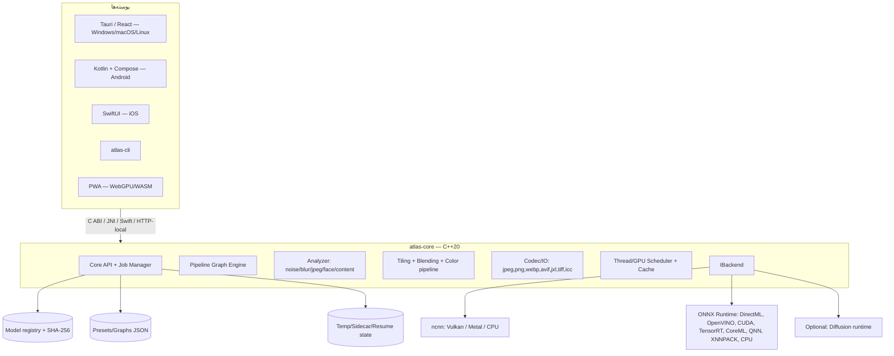

# ۰۵ — معماری نرم‌افزار

## ۱. اصول

1. **یک هسته، چند پوسته.** تمام منطق پردازش در `atlas-core` (C++20) است. UI هیچ الگوریتمی ندارد.
2. **بک‌اند قابل‌تعویض.** مدل‌ها از طریق یک رابط انتزاعی (`IBackend`) اجرا می‌شوند.
3. **پایپ‌لاین اعلانی.** یک گراف JSON توصیف می‌کند چه چیزی اجرا شود؛ همان ایدهٔ API کلاید، اما محلی.
4. **حافظه‌محور، نه فایل‌محور.** پردازش به‌صورت کاشی/نوار جریان دارد؛ تصویر کامل به‌ندرت در RAM نگه داشته می‌شود.
5. **شکست‌پذیر.** هر مرحله می‌تواند fail شود و job از همان‌جا ادامه یابد.
6. **بدون شبکه در مسیر بحرانی.** آپدیت/دانلود مدل، جدا از مسیر پردازش است.

---

## ۲. نمای کلی



---

## ۳. ساختار مخزن پیشنهادی

```
ai-enhancer/
├─ docs/                      # این مستندات
├─ models/catalog.json
├─ core/                      # C++20
│  ├─ include/atlas/          # API عمومی (C ABI + C++)
│  ├─ src/
│  │  ├─ api/                 # job manager, sessions
│  │  ├─ pipeline/            # graph, stages, presets
│  │  ├─ analyze/             # metrics, detectors
│  │  ├─ image/               # buffering, tiling, blending, color
│  │  ├─ io/                  # codecs, icc, metadata
│  │  ├─ backend/             # IBackend, ncnn, ort, metal, webgpu
│  │  ├─ sched/               # threadpool, GPU queue, cache
│  │  └─ util/
│  ├─ third_party/            # submodules: ncnn, onnxruntime, opencv(optional)
│  └─ CMakeLists.txt
├─ ui/
│  ├─ desktop/                # Tauri 2 + React + TS
│  ├─ android/                # Kotlin + Compose
│  └─ ios/                    # SwiftUI
├─ cli/                       # atlas-cli (thin wrapper over core)
├─ web/                       # PWA (ORT-web / WebGPU)
├─ bench/                     # harness + results/
├─ tests/                     # unit, golden images, e2e
└─ tools/                     # model downloader, converter, packager
```

---

## ۴. واحدهای اصلی هسته

| ماژول | مسئولیت | نکات |
|---|---|---|
| `api::JobManager` | صف، اولویت، لغو، ازسرگیری، رویدادها | job id پایدار، state روی دیسک |
| `pipeline::Graph` | اجرای گراف JSON: nodes + edges + params | اعتبارسنجی طرح‌واره، کش نتیجه |
| `analyze::Analyzer` | نویز، تاری، JPEG، محتوا، چهره | سبک، روی CPU؛ قابل خاموش |
| `image::Tiler` | تقسیم هوشمند + دوخت | overlap تطبیقی، reflect pad |
| `image::Color` | خطی‌سازی، white balance، tone curve، ICC | کار در `float32` خطی |
| `io::Codec` | decode/encode + متادیتا | streaming، ۸/۱۶ بیت |
| `backend::IBackend` | اجرای مدل | `loadModel`, `run`, `warmup`, `capabilities` |
| `sched::Scheduler` | threadpool + GPU lock + cache LRU | جلوگیری از oversubscription |
| `models::Registry` | کاتالوگ، SHA-256، لایسنس | enforcement سیاست تجاری |

### ۴.۱ رابط بک‌اند

```cpp
struct BackendCaps {
  bool fp16, int8, vulkan, directml, coreml, qnn;
  size_t vram_bytes, shared_mem_bytes;
  int max_texture_dim;
};
class IBackend {
public:
  virtual ~IBackend() = default;
  virtual BackendCaps caps() const = 0;
  virtual Handle load(const ModelSpec&) = 0;
  virtual void   warmup(Handle) = 0;
  virtual void   run(Handle, const Tensor& in, Tensor& out) = 0;
};
```

پیاده‌سازی‌ها: `NcnnBackend`, `OrtBackend`, `MetalBackend`, `WebGpuBackend`, `DummyBackend` (تست).

### ۴.۲ انتخاب مسیر در زمان اجرا

```
probe:
  1. Vulkan instance → دستگاه‌ها → قابلیت compute + fp16 + max alloc
  2. ONNX Runtime EPs موجود (DirectML/OpenVINO/CoreML/QNN/CUDA)
  3. micro-benchmark: ۳ اجرای ۱۲۸×۱۲۸ روی گزینه‌های موجود → ms
  4. انتخاب: بهترین ms با حافظهٔ کافی، وگرنه fallback بعدی
  5. تعیین tile size از vram و مدل
```

نتیجهٔ probe در `~/.atlas/profile.json` کش می‌شود (با کلید شناسهٔ GPU + نسخهٔ درایور) تا هر بار بنچمارک تکرار نشود.

---

## ۵. گراف پایپ‌لاین (قرارداد اصلی)

```json
{
  "version": 1,
  "input": { "path": "in.jpg", "color_space": "srgb", "bit_depth": 8 },
  "nodes": [
    { "id": "a", "type": "analyze", "params": { "faces": true, "jpeg": true, "content": true } },
    { "id": "b", "type": "decompress", "params": { "mode": "auto" }, "deps": ["a"] },
    { "id": "c", "type": "sr", "params": { "model": "realesrgan-x4plus", "scale": 4,
                                           "tile": 384, "overlap": 32, "fp16": true }, "deps": ["b"] },
    { "id": "d", "type": "face_restore", "params": { "model": "gfpgan-v1.4", "fidelity": 0.7,
                                                     "min_face_px": 48 }, "deps": ["c"] },
    { "id": "e", "type": "light_ai", "params": { "intensity": 40 }, "deps": ["d"] },
    { "id": "f", "type": "sharpen", "params": { "amount": 15, "edge_protect": true }, "deps": ["e"] }
  ],
  "output": { "format": "png", "bit_depth": 16, "keep_metadata": true, "dpi": 300 }
}
```

- هر `type` یک ماژول ثبت‌شده است (`REGISTER_STAGE("sr", SrStage)`).
- پارامترها طرح‌واره دارند (`*.schema.json`) و UI از همان‌ها فرم می‌سازد → **UI و CLI هرگز واگرا نمی‌شوند**.
- گراف قابل ذخیره به‌عنوان پریست است؛ پریست‌های رسمی در `models/presets/`.

---

## ۶. الگوریتم Tiling (شبه‌کد مرجع)

```cpp
for (int y = 0; y < H; y += tile - overlap)
  for (int x = 0; x < W; x += tile - overlap) {
    Rect r = {x, y, min(x+tile, W), min(y+tile, H)};
    Rect pr = expand_with_reflect(r, overlap, W, H);   // reflect padding
    Tensor in = crop_float(src, pr);
    Tensor out = backend.run(model, in);               // scale× خروجی
    Tensor blurred = feather(out);                     // ماسک raised-cosine
    accumulate_with_weight(dst, blurred, pr * scale, weight(r));
  }
```

قواعد عملی:

| مورد | مقدار پیشنهادی |
|---|---|
| overlap | ۱۶px برای ۲x/۴x CNN؛ ۳۲–۶۴px برای transformer/diffusion |
| tile | توان دو (۱۲۸/۲۵۶/۵۱۲) برای کارایی حافظهٔ GPU |
| لبهٔ تصویر | reflect (نه zero) |
| blend | raised-cosine یا linear با وزن مضاعف در مرکز |
| ترتیب | سطر به سطر، تا کاشی‌های همسایه در cache بمانند |
| تصویر بزرگ | پیش‌کوچک‌سازی هوشمند تا سقف هدف (target MP) پیش از SR، برای صرفه‌جویی |

### ۶.۱ محاسبهٔ حافظه (قاعدهٔ سرانگشتی)

```
peak ≈ (tile_out² × C × 4) × (1 + K)
tile_out = tile × scale
K ≈ تعداد feature mapهای هم‌زمان (RRDB 4x: ~۸–۱۲)
```

- tile=256, scale=4 → 1024²×۳×۴ ≈ ۱۲MB برای خروجی، اما فعال‌سازی‌ها ~۱–۲GB.
- در عمل: RRDB x4 با tile ۲۵۶ روی ۴GB VRAM راحت است؛ ۵۱۲ نیازمند ۶–۸GB.
- برای CPU: tile ۹۶–۱۹۲ و INT8.

---

## ۷. جریان داده و حافظه

```
File → mmap/stream decode → planar float32 (linear light) 
     → [stages] → accumulate output tile → encoder (strip-by-strip) → file
```

- **بدون نگه‌داشتن کل تصویر** در حافظه‌های بالا؛ برای عملیات نیازمند کل تصویر (مثل Light AI سراسری) از آماره‌های سبک (هیستوگرام/percentile) استفاده می‌شود.
- برای تصاویر >۵۰MP: حالت `disk-backed` با فایل موقت و `mmap`.
- کش: LRU روی کاشی‌های پردازش‌شده برای پیش‌نمایش تعاملی (کلید: rect+params hash).

---

## ۸. صف کار و ازسرگیری

```json
{
  "job_id": "01J...",
  "input": "D:/photos/a.jpg",
  "preset": "photo-standard",
  "state": "running",
  "progress": 0.42,
  "stage": "sr",
  "tiles_done": 128,
  "tiles_total": 306,
  "started_at": "...",
  "attempts": 1,
  "output_tmp": "C:/Temp/atlas/01J....part.png"
}
```

- state در `%LOCALAPPDATA%/Atlas/jobs/` (ویندوز) یا معادلش.
- لغو = توقف بین کاشی‌ها (نه kill وسط encode).
- خطای GPU → تلاش دوباره با tile کوچک‌تر → سپس CPU → سپس گزارش خطا با لاگ.

---

## ۹. API داخلی (C ABI)

```c
AtlasContext* atlas_create(const AtlasOptions*);
void          atlas_destroy(AtlasContext*);
const char*   atlas_devices_json(AtlasContext*);
int           atlas_run_graph(AtlasContext*, const char* graph_json,
                              AtlasProgressCb, void* user);
int           atlas_cancel(AtlasContext*, const char* job_id);
const char*   atlas_last_error(AtlasContext*);
```

- JNI (اندروید) و Swift (iOS) روی همین ABI سوار می‌شوند.
- سرور محلی اختیاری: `127.0.0.1:47821` با همان JSON گراف (برای اتوماسیون/NAS) — فقط loopback و با توکن.
- CLI: `atlas-cli enhance --graph preset.json --input ... --out ... --json-progress`.

---

## ۱۰. رنگ، دقت و قطعیت

- محاسبات میانی در `float32` و **فضای خطی**؛ تبدیل به sRGB فقط در ورودی/خروجی.
- `Light AI` کلاسیک deterministic است (بدون seed).
- مدل‌ها با `set_num_threads` ثابت و بدون dropout → خروجی تکرارپذیر بیت‌به‌بیت روی یک دستگاه.
- برای مقایسهٔ A/B، همان کاشی و همان seed استفاده می‌شود.

---

## ۱۱. افزونه‌پذیری

- **مدل‌ها**: افزودن یک ورودی به `catalog.json` + تبدیل به ncnn/ONNX (اسکریپت `tools/convert_model.py`).
- **مراحل**: `REGISTER_STAGE` + schema → بلافاصله در UI/CLI/گراف قابل استفاده.
- **پریست‌ها**: JSON خالص؛ قابل اشتراک‌گذاری بین کاربران.
- **پلاگین غیرتجاری**: بستهٔ جدا با `license: non-commercial` که هسته در بستهٔ پیش‌فرض بارگذاری نمی‌کند.

---

## ۱۲. لاگ، خطا و حریم خصوصی

- لاگ محلی چرخشی (`atlas.log`)، بدون محتوای تصویر و بدون مسیر کاربر به‌طور پیش‌فرض.
- کدهای خطای پایدار: `E_MODEL_MISSING`, `E_OOM`, `E_GPU_LOST`, `E_CODEC`, `E_LICENSE`.
- تلمتری: **خاموش پیش‌فرض**؛ حتی اگر روشن شود فقط شمارندهٔ بی‌نام (نسخه، تیر، موفق/ناموفق).
- آپدیت: بررسی نسخهٔ جدید (اختیاری) + امضای بسته.

---

## ۱۳. تصمیم‌های رد‌شده (ADR خلاصه)

| گزینه | چرا رد شد |
|---|---|
| هستهٔ Python (PyTorch) | بستهٔ ۲–۳GB، نصب سخت روی موبایل، GIL، استارت کند |
| Electron | حجم/RAM، نبود دسترسی تمیز به Vulkan |
| Tauri برای موبایل | بلوغ پایین FFI/JNI برای هستهٔ C++ سنگین |
| فقط قالب سفارشی مدل | هزینهٔ تبدیل هر مدل جدید، اکوسیستم محدود |
| Diffusion به‌عنوان پیش‌فرض | روی اکثر دستگاه‌ها غیرقابل اجرا/کند |
