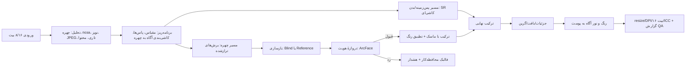

# ۱۴ — نقشهٔ مادر: قوی‌ترین Enhancer برای **عکس واقعی با چهرهٔ واقعی**

> این سند «نقشهٔ کار کامل» است: کیفیت را عددی تعریف می‌کند، مسیر رسیدن را به فازها و Workstream تقسیم می‌کند، و دروازهٔ پذیرش هر فاز را مشخص می‌کند.
> جزئیات فنی پایپ‌لاین در `15-photo-face-pipeline.md`، مدل/آموزش در `16-model-training-plan.md`، سنجش در `17-evaluation-protocol.md` و فایل‌به‌فایل در `18-build-plan-wbs.md`.

---

## ۱. «قوی‌ترین» یعنی چه؟ (تعریف عملیاتی)

برای عکس واقعی با چهرهٔ واقعی، قوی‌ترین یعنی **سه محور هم‌زمان**:

| محور | معنی | معیار |
|---|---|---|
| **هویت (Identity)** | همان آدم بماند: فاصلهٔ چشم، فرم بینی، خط فک، خال و ابرو | ArcFace cosine به منبع/رفرنس |
| **بافت (Texture)** | پوست، مو، پارچه طبیعی بماند؛ نه پلاستیکی، نه نقاشی | LPIPS/DISTS + انرژی فرکانس بالا + داوری انسانی |
| **صحت آناتومی (Plausibility)** | چشم/دندان/گوش/عینک/دست درست باشد؛ آرتیفکت نباشد | نرخ آرتیفکت در بازبینی کور |

### ضداهداف (اگر به آن‌ها برسیم، شکست خورده‌ایم)

- ❌ «زیباتر کردن» چهره (beautification) — تغییر فرم فک، بینی، رنگ پوست.
- ❌ صاف کردن پوست تا حد موم/پلاستیک.
- ❌ اضافه کردن جزئیات اختراعی (طلا، گوشواره، دندان، متن روی لباس).
- ❌ روشن‌تر کردن پوست تیره به‌عنوان «بهبود».
- ❌ تغییر حالت چهره (لبخند، چشم) نسبت به منبع.

> اصل حاکم: **«بازسازی، نه بازآفرینی»**. هر جا مدل نمی‌تواند با اطمینان بازسازی کند، باید محافظه‌کارتر شود و به کاربر بگوید.

---

## ۲. شکست‌های واقعی که باید حل کنیم

| # | سناریو | چرا سخت است | راه‌حل ما |
|---|---|---|---|
| S-01 | عکس واتساپ/تلگرام (JPEG q20–۴۰، ۱۰۸۰px) | بلوک‌های ۸×۸، رنگ‌شیفت، متن روی لباس | deblock قبل از SR + مدل آموزش‌دیده روی زنجیرهٔ فشردگی واقعی |
| S-02 | HEIC آیفون، HDR و شارپن داخلی | هالهٔ شارپن، نویز رنگی، gamut | تشخیص هاله + کاهش شارپن معکوس + مدیریت رنگ |
| S-03 | عکس شب با فلاش/نویز بالا | نویز رنگی، از دست رفتن بافت پوست | denoise وفادار + بازسازی نویز واقع‌گرا (grain) |
| S-04 | عکس گروهی (چهره‌های ۲۰–۶۰px) | چهرهٔ کوچک = اطلاعات ناکافی | آستانهٔ اندازه + حالت محافظه‌کار + هشدار |
| S-05 | پروفایل/سلفی با چهرهٔ بزرگ | انتظار بالا، هویت حیاتی | حالت Reference-locked |
| S-06 | عینک، ریش، آرایش، گوشواره | مدل ممکن است حذف/تغییر دهد | ماسک face-parsing + محافظت لبه |
| S-07 | پوست تیره/روشنایی کم | سوگیری مدل‌ها، روشن‌سازی ناخواسته | تست لایه‌بندی‌شده + منحنی رنگ مخصوص پوست + ΔE guard |
| S-08 | چهرهٔ پروفایل (نیم‌رخ) | دیتاست‌ها عمدتاً روبه‌رو | تشخیص yaw + مدل/شدت محافظه‌کار |
| S-09 | عکس اسکن/قدیمی/B&W | خش، رنگ‌رفتگی، عدم تطابق رنگ | inpaint + colorization + بازسازی چهره |
| S-10 | اسکرین‌شات از عکس (moiré) | الگوی تداخلی | تشخیص + فیلتر moiré + SR |
| S-11 | تاری حرکتی | کرنل جهت‌دار | تخمین کرنل + deblur جهت‌دار |
| S-12 | بچه/سالمند | پوست و تناسبات خاص | مجموعهٔ تست و آموزش جداگانه |

---

## ۳. نوار کیفیت (Quality Bar) — عددی

### ۳.۱ چهره

| معیار | آستانهٔ نسخهٔ ۱.۰ | نحوهٔ سنجش |
|---|---|---|
| هویت (ArcFace cosine به منبع) — چهره ≥۹۶px | میانه ≥ **۰٫۶۵**، کمتر از ۵٪ زیر **۰٫۵** | مجموعهٔ طلایی |
| هویت در حالت Reference-locked | میانه ≥ **۰٫۸۰** | با ۱–۴ رفرنس |
| حفظ لندمارک (LMD) | ≤ ۱٫۰۵× منبع | ۶۸ نقطه |
| آزمون «همان شخص است؟» (انسان) | ≥ **۹۵٪** | ۳ داور، کور |
| نرخ آرتیفکت شدید | < **۲٪** چهره‌ها | بازبینی کور |
| حفظ حالت/بیان | ≥ **۹۸٪** بدون تغییر محسوس | مقایسهٔ جفتی |
| ΔE پوست (بدون تغییر نور) | < **۳** | ΔE2000 |

### ۳.۲ عکس (غیرچهره)

| معیار | آستانه |
|---|---|
| NIQE / BRISQUE | بهبود ≥ ۱۵٪ نسبت به ورودی |
| MUSIQ / CLIPIQA | بدون افت (≥ −۲٪) |
| LPIPS/DISTS نسبت به مرجع (وقتی موجود) | بدون رگرسیون نسبت به نسخهٔ قبل |
| نرخ هاله (halo) در لبه‌های کنتراست بالا | < ۵٪ تصاویر |
| banding در گرادیان آسمان | ۰ مورد در تست |

### ۳.۳ پایداری

| معیار | آستانه |
|---|---|
| تکرارپذیری (دو اجرای یکسان) | تفاوت پیکسلی صفر در مسیر deterministic |
| حافظه | < ۱٫۵GB دسکتاپ / < ۶۰۰MB موبایل (پیش‌فرض) |
| بدون کرش | ۱۰۰۰ فایل دسته‌ای × ۳ دستگاه |

---

## ۴. حالت‌های محصول (چهار حالت، نه بیشتر)

| حالت | چه می‌کند | برای چه کسی | پیش‌فرض |
|---|---|---|---|
| **Natural** | بازسازی محافظه‌کار، حفظ کامل هویت، بدون زیباسازی | پرتره، عکس خانوادگی، سند | ✅ |
| **Max Detail** | بازسازی تهاجمی‌تر بافت (Ultra-like) | بنر، چاپ بزرگ، عکاسی | — |
| **Reference-locked** 🔒 | با ۱–۴ عکس رفرنس از همان شخص، هویت قفل می‌شود | آرشیو خانوادگی، پرترهٔ حرفه‌ای، بازسازی عکس قدیمی | پیشنهاد خودکار وقتی رفرنس موجود است |
| **Restore Old** | خش/پارگی/رنگ‌رفتگی + چهره + بزرگ‌نمایی | عکس قدیمی | — |

> حالت «زیباسازی» عمداً وجود ندارد. اگر کاربر بخواهد، یک preset جداگانه و برچسب‌خورده در آینده.

---

## ۵. نمای کلی مسیر پردازش



---

## ۶. Workstreamها

| WS | نام | محدوده | خروجی |
|---|---|---|---|
| **WS-A** | هسته و زیرساخت | بافر، کاشی، صف، بک‌اند، CLI | `core/` قابل استفاده |
| **WS-B** | پایپ‌لاین چهره | detect/align/restore/gate/composite | ماژول `face/` |
| **WS-C** | کیفیت عکس | deblock، denoise، SR، بافت، رنگ | مراحل `stages/` |
| **WS-D** | مدل و آموزش | انتخاب، تبدیل، فاین‌تیون، دیستیل، کوانت | `models/` + گزارش |
| **WS-E** | ارزیابی | مجموعهٔ طلایی، متریک، تست انسانی، انصاف | `bench/` + گزارش |
| **WS-F** | پلتفرم‌ها | ویندوز، اندروید، iOS/مک، PWA | بسته‌های امضاشده |
| **WS-G** | UX و ایمنی | حالت‌ها، هشدارها، رضایت، provenance | UI + سیاست |

وابستگی: `WS-A → (WS-B, WS-C) → WS-D → WS-E → WS-F/WS-G`. ارزیابی از روز اول موازی اجرا می‌شود (نه در پایان).

---

## ۷. فازها و دروازه‌ها

| فاز | هدف | خروجی | دروازهٔ پذیرش (Gate) | مدت |
|---|---|---|---|---|
| **P0** | اسکلت اجرایی | CLI + پایپ‌لاین + SR کاشی‌ای روی CPU/Vulkan | ۱۲MP→۴x روی iGPU، بدون کرش | ۳ هفته |
| **P1** | چهرهٔ پایه | detect/align/GFPGAN/ترکیب | «همان شخص» ≥۸۵٪، بدون آرتیفکت شدید <۵٪ | ۳ هفته |
| **P2** | کیفیت عکس | deblock/denoise/بافت/رنگ | NIQE −۱۵٪، halo <۵٪ | ۳ هفته |
| **P3** | دروازهٔ هویت + حالت Natural | ArcFace gate + فالبک + هشدار | هویت میانه ≥۰٫۶۵، <۵٪ زیر ۰٫۵ | ۲ هفته |
| **P4** | Reference-locked | رفرنس ۱–۴ عکسی + خوشه‌بندی هویت در batch | هویت میانه ≥۰٫۸۰ | ۴ هفته |
| **P5** | Max Detail + Old Photo | بازسازی تهاجمی + مرمت قدیمی | A/B کور ≥۵۰٪ برد/مساوی | ۴ هفته |
| **P6** | تثبیت و انتشار | بنچمارک کامل، بسته‌بندی، مستندات | همهٔ نوارهای کیفیت | ۳ هفته |

جمع: **~۲۲ هفته** برای خط پایهٔ کامل روی دسکتاپ (با تیم ۲–۳ نفره). موبایل موازی از P2 شروع می‌شود.

---

## ۸. مسیر بحرانی و موازی‌سازی

```
P0 ──► P1 ──► P3 ──► P4 ──► P6
        └──► P2 ──► P5 ──┘
WS-E (ارزیابی) از هفتهٔ ۲ ────────────────────►
WS-F (اندروید) از P2 ───────────────►
```

- **بحرانی‌ترین ریسک:** کیفیت چهره (P1/P3/P4). اگر P3 رد شود، P4 معنا ندارد.
- **بیشترین اهرم:** Reference-locked؛ تفاوت واقعی با رقبا و تأثیر مستقیم بر هویت.
- **بیشترین هزینه:** آموزش/فاین‌تیون (WS-D) — باید از P2 شروع شود تا در P4 آماده باشد.

---

## ۹. تیم و تخصیص

| نقش | FTE | فازهای اصلی |
|---|---|---|
| C++/Infra | ۱ | P0، P2، P6 |
| ML/Face | ۱ | P1، P3، P4، P5 |
| Full-stack/UI | ۱ | P0، P6 |
| Mobile | ۰٫۵ | P2–P6 |
| QA/Evaluation | ۰٫۵ | P2–P6 (داوری انسانی) |

---

## ۱۰. ریسک‌های مخصوص چهره

| ریسک | اثر | کاهش |
|---|---|---|
| هویت‌دریفت (تبدیل به آدم دیگر) | فاجعهٔ محصولی | دروازهٔ ArcFace + فالبک + Reference mode |
| مدل‌های برتر چهره غیرتجاری‌اند (CodeFormer) | حقوقی | پیش‌فرض GFPGAN + پلاگین CodeFormer/Ref-FR با هشدار |
| Reference mode به «face swap» تبدیل شود | اخلاقی/قانونی | محدودیت: فقط همان شخص، امتیاز هویت بالا، عدم پذیرش رفرنس متفاوت |
| پوست تیره روشن‌تر شود | تبعیض/اعتماد | منحنی جدا، ΔE guard، تست لایه‌ای، بازبینی انسانی |
| چهره‌های کوچک با توهم بازسازی شوند | اطلاعات جعلی | آستانهٔ اندازه + هشدار «بازسازی حدسی» |
| مدل‌های Ref-FR سنگین (Diffusion) | کارایی | دیستیل single-step + فقط روی تیر A/A+ |

---

## ۱۱. تعریف «۱.۰ آماده است»

- [ ] هر چهار حالت محصول با نوار کیفیت بخش ۳.
- [ ] دروازهٔ هویت فعال و قابل تنظیم (Conservative ↔ Bold).
- [ ] Reference-locked با ۱–۴ رفرنس و خوشه‌بندی خودکار در batch.
- [ ] گزارش QA برای هر تصویر (امتیاز هویت، هشدار توهم، نواحی مشکوک).
- [ ] تست انصاف روی ۶ تیپ پوستی و ۴ گروه سنی.
- [ ] بدون مدل غیرتجاری در بستهٔ پیش‌فرض.
- [ ] مستند «چه چیزی را تغییر می‌دهیم و چه چیزی را نه» برای کاربر.

---

## 📝 یادداشت من (پایان این فایل)

**تاریخ:** ۲۰۲۶-۱۱-۱۱ · **فایل:** `docs/14-masterplan-real-photo-face.md` · **وضعیت:** کامل

- **آنچه مسلم شد:** «قوی‌ترین» بدون تعریف عددی هویت/بافت/آناتومی قابل ادعا نیست؛ و بدون **دروازهٔ ArcFace** هر مدل چهره‌ای می‌تواند هویت را عوض کند.
- **تصمیم کلیدی:** Reference-locked به‌عنوان تمایز اصلی، نه یک قابلیت جانبی.
- **فرض:** مدل‌های Ref-FR (InstantRestore/FaceMe/RestorerID) در ۲۰۲۶ بالغ شده‌اند؛ باید از نظر لایسنس و اجرا روی ONNX/ncnn بررسی شوند.
- **سؤال باز:** آیا Reference mode در ۱.۰ باشد یا ۱.۱؟ (وابسته به P4)
- **قدم بعدی:** نوشتن spec دقیق پایپ‌لاین چهره و سپس WBS فایل‌به‌فایل.
